# Kanji Wizards · v0.9.9.9.7.4

**Learn Japanese by casting it.** Kanji Wizards is a free multiplayer game where every word you study becomes a
spell. Read a kanji, type its reading or write it by hand, and your wizard casts it at your opponent. Study with
spaced-repetition flashcards, climb the Daily challenge leagues from Kana to N1, and play your friends in real time
on the web, on Android or on Windows.

  <a href="https://kanji-battle-ev0o.onrender.com/"><b>Play in the browser</b></a> ·
  <a href="https://github.com/Mashxur-Lee/kanji-battle/releases/latest/download/KanjiWizards.apk">Android app</a> ·
  <a href="https://github.com/Mashxur-Lee/kanji-battle/releases/latest/download/KanjiWizards-Setup.exe">Windows app</a>

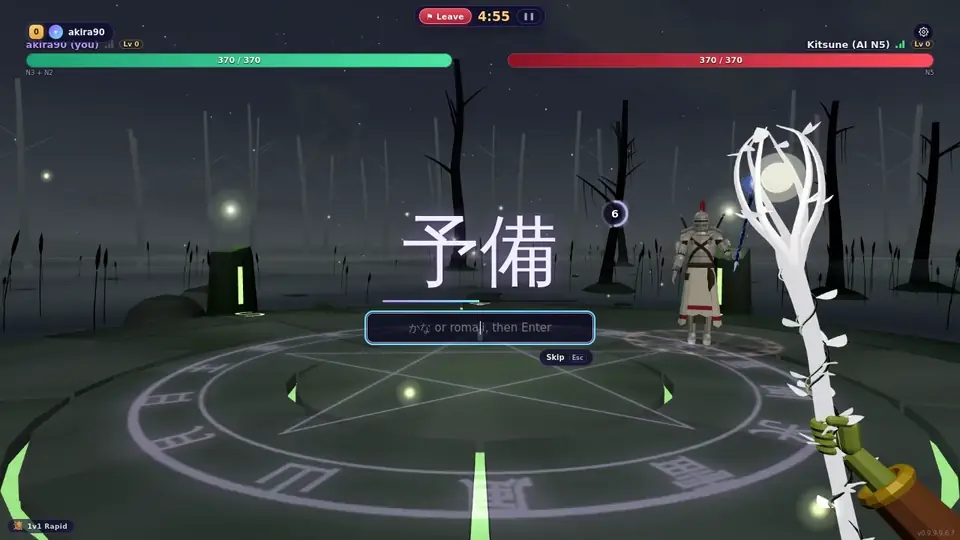

<a href="docs/promo/trailer.mp4"><b>Watch the full trailer</b></a> (a minute and a half, with its own soundtrack) · <a href="docs/promo/trailer-short.mp4">the 40-second cut</a>

## What's inside

- **Five battle modes**: 1v1 Kanji Reading, 1v1 Kanji Writing (handwriting recognition), 1v1 Rapid, Deck Duel
  (a card game built from your own words), and Boss Elimination (up to four players against the Black Dragon).
- **Combos that matter**: answer fast and right to chain combos, go *On fire* at ×5, and land critical hits.
- **Study that sticks**: Anki-style flashcards for every JLPT level (N5–N1) with stroke-order animations, a Kana
  trainer for hiragana and katakana, JLPT quizzes, onomatopoeia and reading passages, and a full
  Japanese–English–Russian dictionary.
- **Daily challenge leagues**: ten words a day, the same for everyone in your league. Pass a league to earn its
  animated frame and move up, or race the best of your friends word by word.
- **Friends**: a friends list, invites, and a messenger with groups, photos, reactions and @mentions.
- **Your wizard**: four characters, magic staffs, flames, poses, frames and painted arenas, earned by playing and
  studying. The battles play in a 3D arena or in 2D.
- **Everywhere**: phone, tablet and computer, with an offline mode for studying. English and Russian.

## A closer look

<table>
  <tr>
    <td width="50%">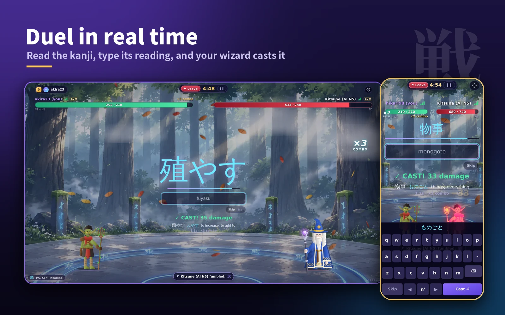</td>
    <td width="50%">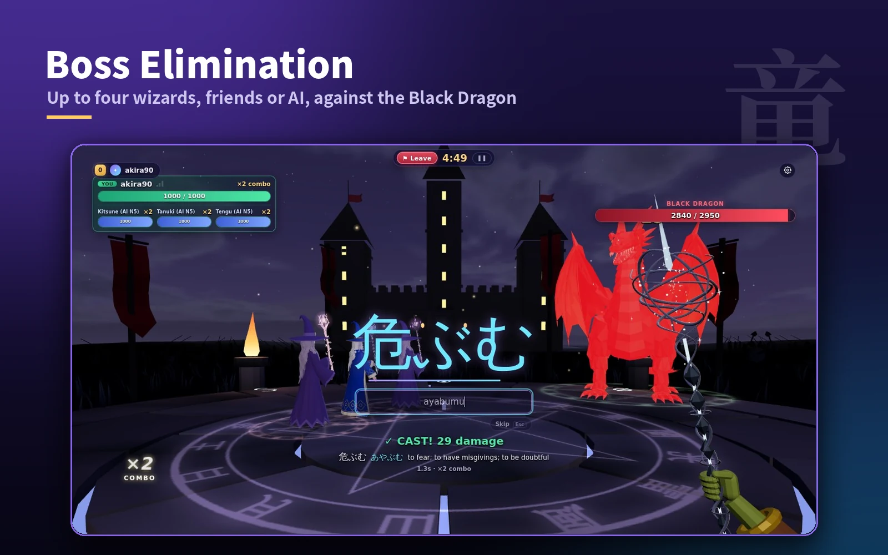</td>
  </tr>
  <tr>
    <td width="50%">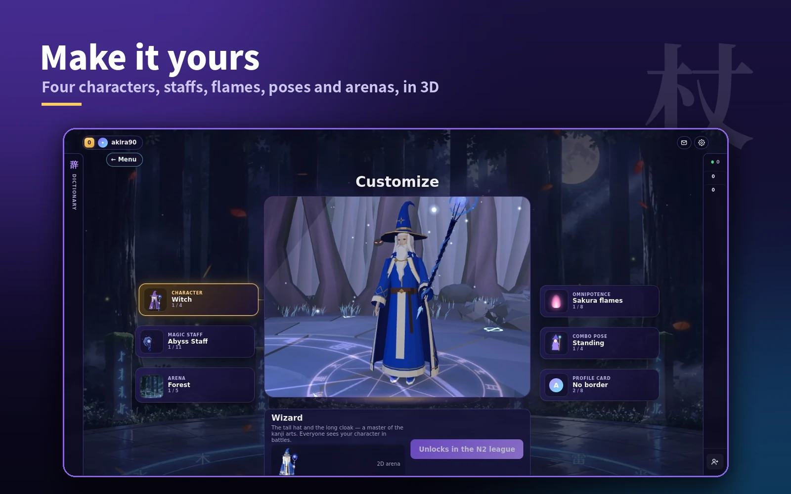</td>
    <td width="50%">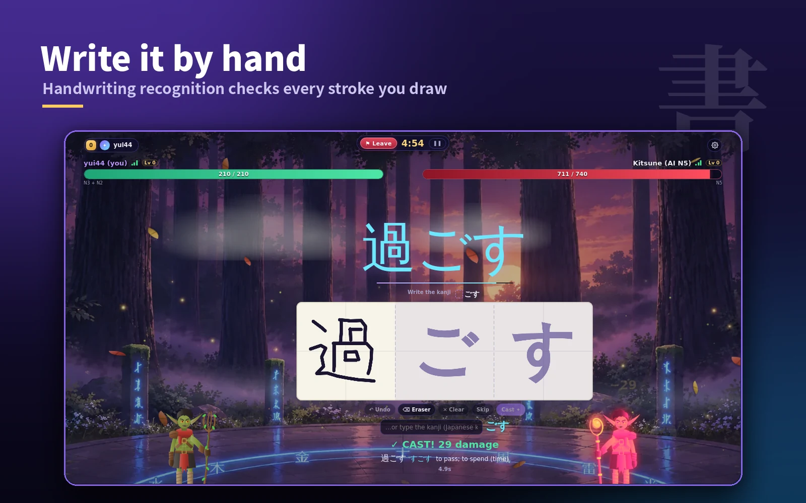</td>
  </tr>
  <tr>
    <td width="50%">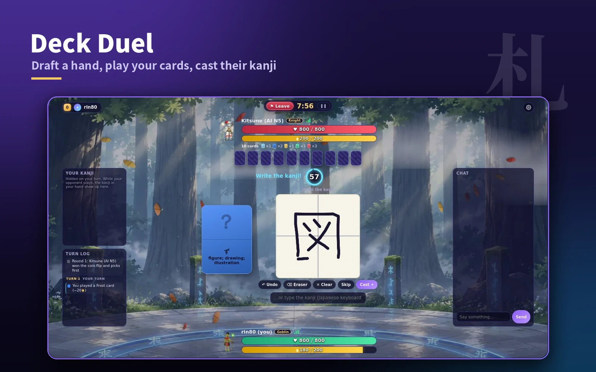</td>
    <td width="50%">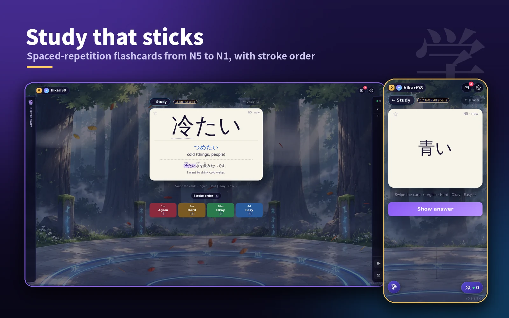</td>
  </tr>
  <tr>
    <td width="50%">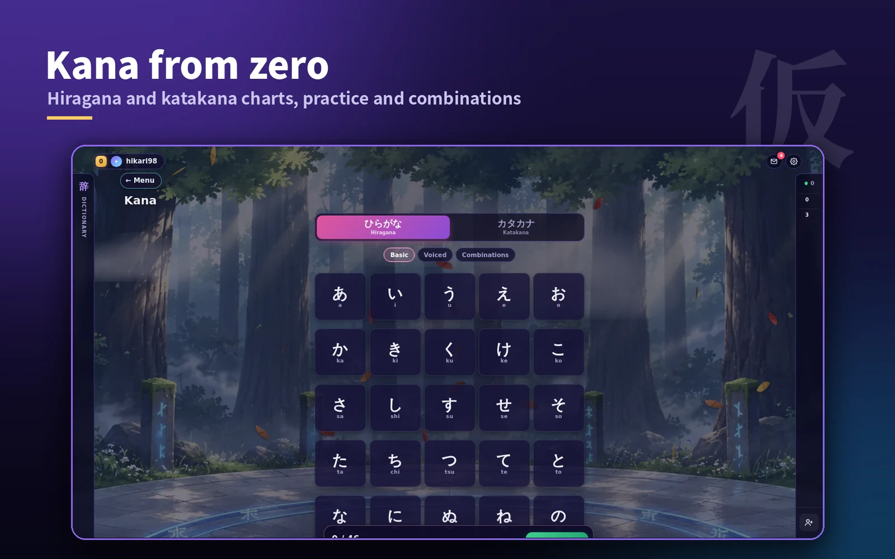</td>
    <td width="50%">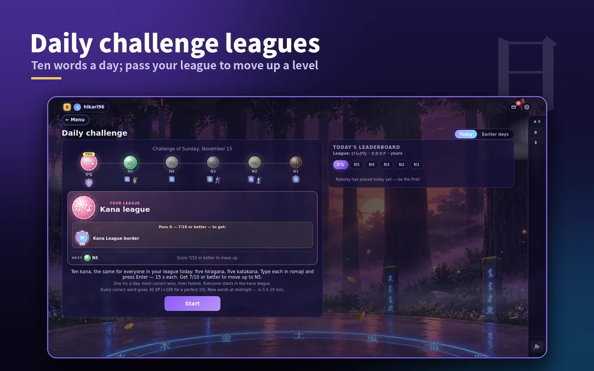</td>
  </tr>
  <tr>
    <td width="50%">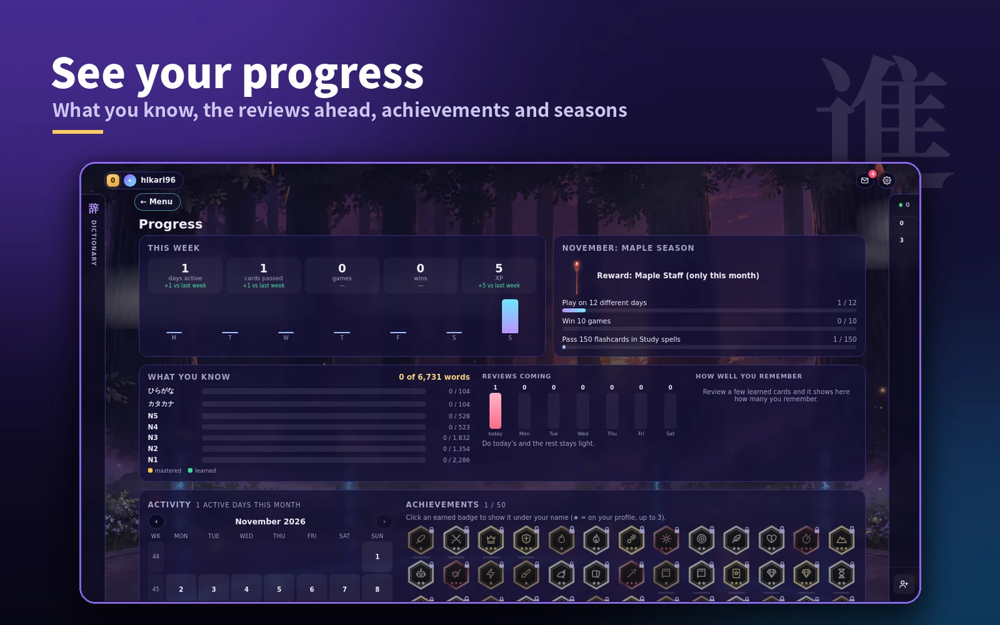</td>
    <td width="50%">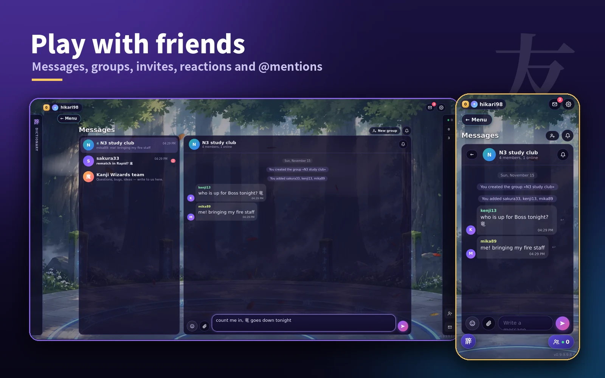</td>
  </tr>
  <tr>
    <td width="50%">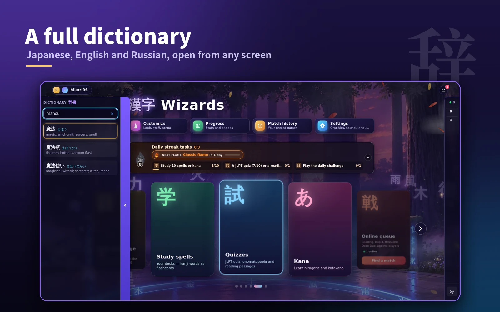</td>
    <td width="50%">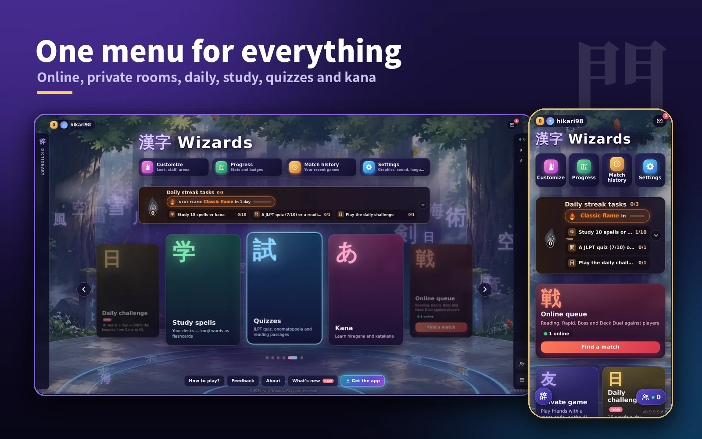</td>
  </tr>
</table>

## Built with

TypeScript on both sides: a Node.js server (WebSocket games, REST API, PostgreSQL) and a browser client bundled
with esbuild, with three.js for the 3D arena. The Android app is a small WebView shell with push notifications;
the Windows app is Electron.

- Running your own server, building the apps, environment variables: [docs/SETUP.md](docs/SETUP.md)
- Credits and licences of the word data, the dictionary and the libraries: [CREDITS.md](CREDITS.md)
- Found a bug or have an idea? Use **Feedback** in the game's main menu.

© Kanji Wizards — all rights reserved. The source is public to read, not to reuse: see [LICENSE](LICENSE).
